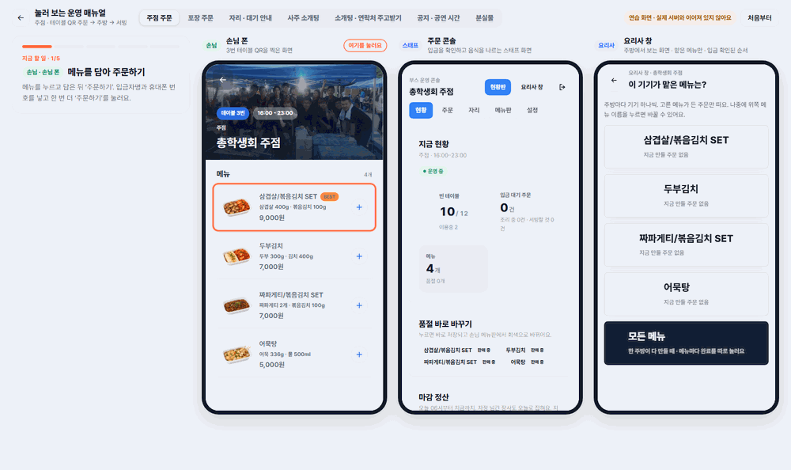
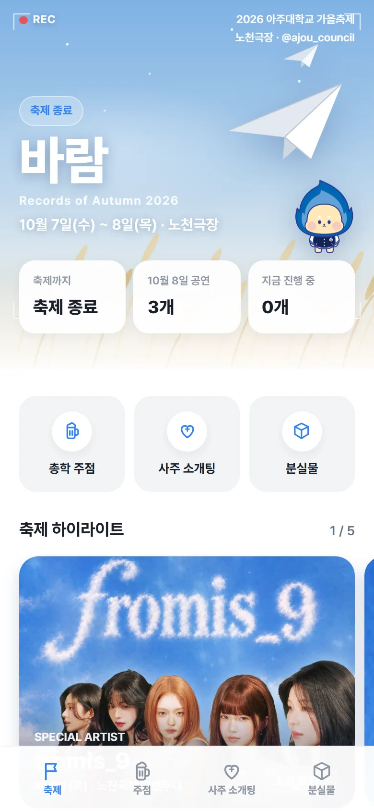
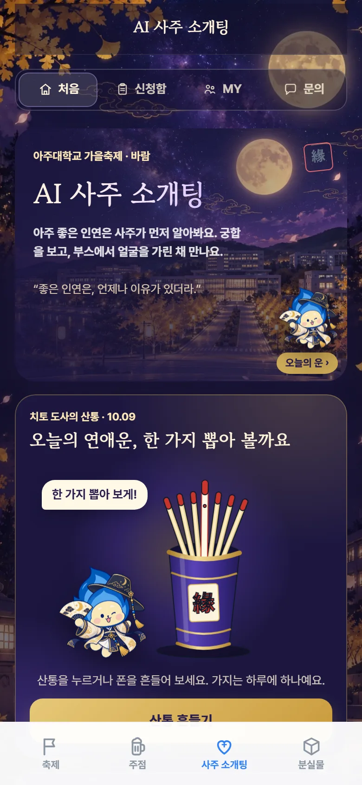
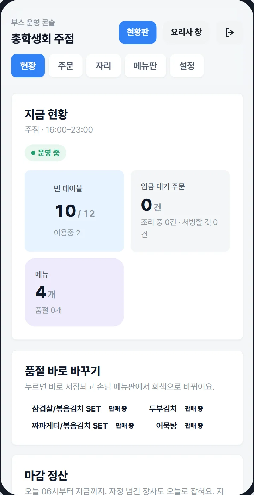
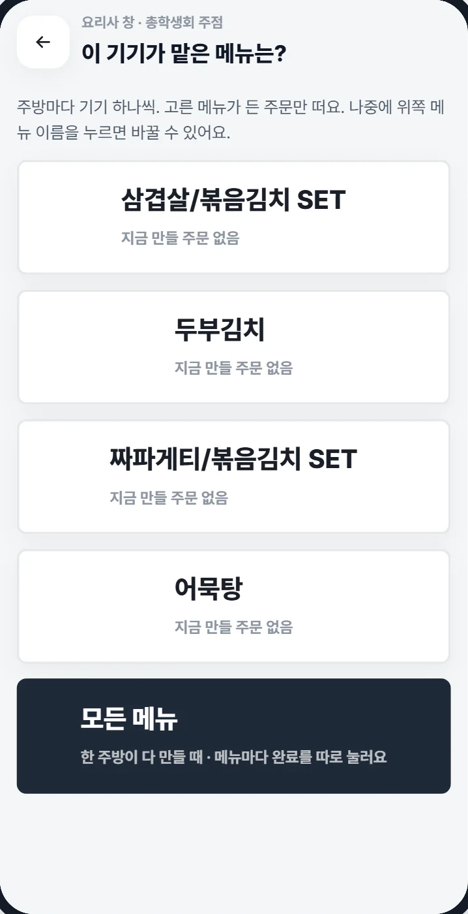
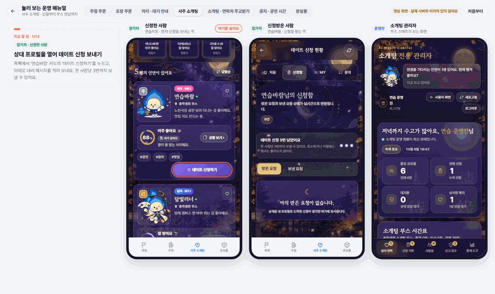
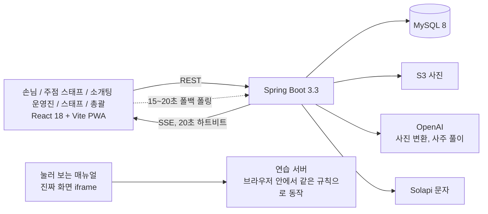

# FestFlow

> **공개 사본입니다 (2026-11-13).** 원본 저장소는 축제 참가자의 사진과 DB 를 뽑은 파일이 커밋 기록에 남아 있어 공개하지 않습니다. 이 저장소는 최신 코드만 한 커밋으로 옮긴 것입니다.
>
> - 뺀 것: 업로드 사진(`backend/uploads/`), DB 덤프와 5월 예측 모델 파일(`exports/`), 사람이 찍힌 사진 2장, 총학생회 카드뉴스 이미지 폴더, 로그와 임시 파일, 문서용 화면 캡처 모음(`docs/assets/`).
> - 가린 것: 문의처 전화번호와 담당자 이름, 주점 입금 계좌와 예금주, 로컬 DB 비밀번호 기본값. 가린 자리는 `010-0000-0000` · `담당자` · `연습은행 000-0000-0000` 으로 바꿨습니다.
> - 그래서 달라지는 것: 카드뉴스 그림과 주점 대표 사진이 비어 보이거나 마스코트 그림으로 나옵니다. 코드와 테스트는 그대로이고 `./gradlew test` 는 127개가 통과합니다.
> - 원본의 커밋은 316개(2026-04-01 ~ 2026-10-09)입니다. 날짜별로 무엇을 왜 바꿨는지는 [docs/festflow/테스트-중-바꾼-것.md](docs/festflow/테스트-중-바꾼-것.md)에 있습니다.
> - 축제 뒤에 더한 것: [동시 주문 시험](docs/festflow/동시-주문-시험.md)(실제 PostgreSQL 에서 주문 100건을 겹쳐 본 테스트와 잠금을 뺀 대조군), [부하 시험 다시 재기](docs/festflow/부하-시험.md)(스크립트와 결과 원문 포함).

아주대학교 축제에서 실제로 쓴 축제 앱입니다. 손님은 타임테이블과 주점 QR 주문, 사주 소개팅, 분실물을 보고, 주점 스태프는 주문 콘솔과 요리사 창을, 소개팅 운영진과 전체 스태프, 총괄은 각자 화면을 씁니다. 혼자 기획하고 개발하고 배포해서 두 번 운영했습니다. 2026년 5월 대동제에서 AI 소개팅을 하루 돌렸고, 2026년 10월 가을축제 "바람"에서는 이틀 동안 전체 기능을 돌렸습니다. 10월에는 방문자 7,078명, 첫날 주점 주문 142건, 소개팅 가입 322명을 서버 장애 없이 받았습니다.



| | |
|---|---|
| 기간 | 2026.04 ~ 2026.10, 커밋 311개, 1인 개발 |
| 현장 운영 | 2026-05-20 ~ 22 대동제, 2026-10-07 ~ 08 가을축제 "바람" |
| 배포 | https://www.ajoufesta.com (프론트 Vercel, 백엔드 Railway, MySQL, 사진은 S3) |
| 결산 | [docs/festflow/축제-결산.md](docs/festflow/축제-결산.md) |

## 주요 코드

1. [`OrderService.java#L464-L492`](backend/src/main/java/com/festflow/backend/service/OrderService.java#L464-L492) `markItemDone`. 주점 주방이 메뉴별로 4곳이라서 "완료"가 주문 단위가 아니라 메뉴 줄 단위입니다. 주문 행을 잠그고 줄 하나를 완료 처리하고, 첫 줄이 끝나면 조리 중, 모든 줄이 끝나면 서빙할 것으로 상태를 올립니다. 축제 전날 밤에 총학에서 주방이 4곳으로 나뉜다고 알려 줘서 급하게 만든 부분입니다.
2. [`AiMatchService.java#L1373-L1402`](backend/src/main/java/com/festflow/backend/service/AiMatchService.java#L1373-L1402) `consentContactShare`. 매칭은 됐는데 부스 시간을 못 잡은 커플이 서로 동의하면 전화번호를 주고받는 기능입니다. 둘 다 동의했을 때만 번호가 열리고, 동시에 눌러도 한쪽 동의가 지워지지 않게 행을 잠급니다. 축제 첫날 밤에 만들어서 둘째 날 아침에 배포했습니다.
3. [`CouncilBoothSync.java#L93-L137`](backend/src/main/java/com/festflow/backend/init/CouncilBoothSync.java#L93-L137). 서버가 켜질 때 주점 기본 정보를 넣는 코드인데, 비어 있는 칸만 채웁니다. 총학에서 확정 정보가 세 번 바뀌었지만 운영 DB를 손으로 고친 적은 없고, 운영진이 콘솔에서 바꾼 품절이나 계좌가 재배포 때 덮이지도 않았습니다.

## 주요 화면

| | |
|---|---|
|  |  |
| 손님 첫 화면입니다. 하이라이트 배너, 날짜별 타임테이블, 총학 카드뉴스 11묶음(이미지 대신 코드로 다시 그렸습니다)이 있고 아래 탭으로 주점, 소개팅, 분실물로 갑니다. 주점에서는 테이블 QR을 찍어 주문하고 계좌이체 후 상태 화면에서 조리 상황을 봅니다. 포장 주문도 됩니다. | 사주 소개팅입니다. 전화번호, 사진(AI로 웹툰풍 변환), 생년월일로 가입하면 사주와 궁합이 나오고, 신청과 수락 후 20분 단위로 만날 시간을 잡습니다. 당일에는 각자 대기 장소에서 도착 버튼을 누르면 스태프가 부스로 데려가고, 블라인드 채팅 10분 후 둘 다 원하면 얼굴을 봅니다. |
|  |  |
| 주점 스태프의 주문 콘솔입니다. 입금 대기 주문이 들어온 순서로 보이고, 새 주문과 음식 완료 때 소리가 납니다. 품절 바꾸기, 대기 시간 안내, 마감 정산과 CSV 내려받기가 있습니다. 자리 현황판과 테이블 QR 인쇄 화면도 따로 있습니다. | 요리사 창입니다. 기기마다 맡은 메뉴를 고르면 그 메뉴가 들어간 주문만 입금 순서로 보이고, 메뉴마다 완료를 누릅니다(5초 안에 되돌리기 가능). 모든 메뉴가 끝난 주문만 콘솔의 "서빙할 것"으로 넘어갑니다. |



그 밖에 스태프 화면(`/staff`, 부스 암호로 열고 명찰과 상태, 지금 위치, 밥 교대, 내 시간표, 연락처, 시간표 수정과 엑셀 올리기), 소개팅 운영진 화면(`/ai-match/admin`, 시간표, 현장 체크인, 채팅 시작, 노쇼 처리, 사진 검수, 신고, 새 가입 막기, CSV), 총괄 화면(`/admin`, 공지와 공연 일정, 분실물 등록), 눌러 보는 운영 매뉴얼(`/guide/live`)이 있습니다. 권한은 세 가지입니다. 총괄과 소개팅 운영진은 JWT 로그인, 주점과 스태프 화면은 운영 키, 손님 화면은 로그인 없이 씁니다.

## 5월 운영 이후 바뀐 것

5월 대동제에서는 AI 소개팅만 하루 돌렸습니다(등록 169명, 신청 424건, 성사 36건). 그때 문제가 많이 드러났고 10월 전에 다 고쳤습니다.

| 5월 | 10월 |
|---|---|
| 한 사람이 신청을 몇 번이든 보낼 수 있었다 | 1인당 3건으로 제한([`AiMatchService.java#L93`](backend/src/main/java/com/festflow/backend/service/AiMatchService.java#L93)). 신청 420건이 들어와도 한 사람에게 몰리지 않았다 |
| 신청마다 문자가 나가서 오후에 잔액이 떨어졌고, 244통이 실패했다. 문자 전송 실패가 500 에러로 올라왔다 | 문자 실패는 로그만 남기고 저장은 그대로 유지한다([`AiMatchSmsNotifier.java#L134-L138`](backend/src/main/java/com/festflow/backend/service/notification/AiMatchSmsNotifier.java#L134-L138)). 알림은 한 통씩 보내고, 조율 문자는 번호당 2분에 한 통만 보낸다. 이틀 동안 문자 문제가 없었다 |
| 만남 시간은 운영진이 전화로 잡았다 | 앱에서 시간 제안, 확정, 30분 전 알림, 당일 안내, 블라인드 채팅까지 처리한다. 부스에서 30쌍이 만났다 |
| 참가자가 너무 많아져도 막을 방법이 없었다 | 운영진 화면에 새 가입 막기 스위치를 두었다. 부스 시간을 못 잡은 커플은 서로 동의하면 연락처를 주고받는다 |
| 검증 안 한 기능을 당일에 냈다 | 눌러 보는 매뉴얼로 7개 흐름을 끝까지 돌려 보고, 축제 전에 점검을 세 번 해서 당일에 사고 날 만한 것 20개 정도를 미리 고쳤다 |
| 테스트 3파일 | 테스트 23파일. 실제 화면을 여러 기기 크기로 돌려 보는 Playwright 스크립트 |

무엇을 왜 바꿨는지는 [테스트-중-바꾼-것.md](docs/festflow/테스트-중-바꾼-것.md)에 날짜별로 적어 두었습니다.

## 구조



| 백엔드 | 프론트 | 매뉴얼과 시험 |
|---|---|---|
| Java 17, Spring Boot 3.3, Spring Security, JPA, JWT, SseEmitter | React 18, Vite, React Router, PWA | 눌러 보는 매뉴얼 흐름 7개(`frontend/src/demo/`) |
| 컨트롤러 29개, 자바 25,357줄, 테스트 23파일 | 페이지 24개, JS 41,391줄 | Playwright로 실제 화면을 폰, 태블릿, 노트북 폭으로 돌리는 스크립트 |

## 설계 결정

### 실시간 처리

바뀌는 정보는 거의 다 서버에서 화면 쪽으로만 흐릅니다(주문이 들어오면 콘솔과 요리사 창이 바뀌고, 운영진이 공지를 올리면 손님 화면이 바뀝니다). 그래서 WebSocket 대신 SSE를 쓰고 채널을 종류별로 나눴습니다([`StreamController.java`](backend/src/main/java/com/festflow/backend/controller/stream/StreamController.java)). 5월에는 재연결을 브라우저에 맡겼는데, 10월 점검에서 하트비트가 없어서 죽은 연결이 쌓이는 것과 재배포 후 화면이 조용히 멈추는 문제가 보였습니다. 20초 하트비트를 넣고, 이벤트는 DB 커밋 후에 보내고, 주문 상태 화면과 콘솔, 요리사 창은 15~20초마다 다시 읽게 했습니다([`StreamService.java`](backend/src/main/java/com/festflow/backend/service/stream/StreamService.java)). 요청이 좀 늘지만 로컬 부하 시험(SSE 6,000개 연결 + 가상 방문자 600명)에서 초당 1,104건, p95 443ms, 오류 0이라 괜찮다고 봤습니다.

### 서버 기본값

총학에서 받은 확정 정보(운영시간, 계좌, 메뉴, 테이블, 타임테이블)는 코드에 기본값으로 넣어 두고 서버가 켜질 때 DB에 씁니다. 처음 한 번만 그대로 넣고, 그 다음부터는 비어 있는 칸만 채웁니다([`CouncilBoothSync.java#L98-L137`](backend/src/main/java/com/festflow/backend/init/CouncilBoothSync.java#L98-L137)). 운영진이 콘솔에서 바꾼 값은 재배포해도 안 바뀝니다. 축제 정보는 늦게, 여러 번 바뀌는데 이게 없었으면 배포할 때마다 DB를 손으로 맞춰야 했을 겁니다. 반대로 분실물과 공지는 이 원칙을 안 지켜서 운영 서버에 시연용 가짜 분실물이 손님에게 보이는 사고가 났고, 10월에 시연 데이터를 지우는 쪽으로 고쳤습니다.

### 운영 매뉴얼

스태프 50여 명이 당일에 처음 보는 화면을 써야 합니다. 사진 매뉴얼은 읽어도 금방 잊습니다. 그래서 `/guide/live`는 손님 폰, 주문 콘솔, 요리사 창 같은 실제 페이지를 iframe으로 나란히 띄우고, 네트워크 요청은 브라우저 안의 연습 서버가 받아서 실제 서버와 같은 규칙으로 응답합니다. 누를 곳에 테두리가 표시되고, 누르면 옆 화면이 바뀝니다. 운영 데이터는 건드리지 않습니다. 같은 장치를 테스트에도 씁니다. Playwright가 테두리만 따라 눌러서 끝까지 가는지 확인하는 방식입니다.

### 여러 기기의 동시 수정

주점 콘솔은 폰 서너 대가 동시에 열려 있습니다. 처음에는 저장할 때 화면 값을 통째로 보냈는데, 그러면 한 폰에서 건 품절이나 바꾼 계좌가 다른 폰의 저장 때문에 조용히 원래대로 돌아갔습니다. 지금은 저장 직전에 서버 값을 다시 읽고 이 폰에서 실제로 바꾼 칸만 얹어서 보냅니다([`OpsBoothPage.jsx#L190`](frontend/src/pages/OpsBoothPage.jsx#L190) `mergeOntoServer`). 소개팅 스태프 화면의 안내 단계도 같은 문제가 있어서, 버튼이 보고 있던 단계를 같이 보내고 서버 상태가 다르면 거절합니다. 주문 상태는 서버가 뒤로 못 돌리게 막아서, 늦게 누른 기기는 409를 받고 화면을 다시 읽습니다.

## 운영 지표

2026-10-07 ~ 08 가을축제 "바람". 자세한 표는 [결산](docs/festflow/축제-결산.md)에 있습니다.

| | |
|---|---|
| 방문 (Vercel) | 방문자 7,078명, 조회 26,243회, 10월 7일 하루 약 5,000명. 유입은 인스타그램 2.4K, 에브리타임 1.7K |
| 주점 10월 7일 | 주문 142건, 입금 확인 매출 2,462,000원, 테이블 60개 중 55개 사용, 포장 9건, 피크는 18시 42건 |
| 주문 후 입금 확인까지 | 중앙값 48초, 90%가 2.3분 안 |
| 입금 확인 후 서빙까지 | 중앙값 31분, 피크 시간(18~19시, 21시)에는 40분 넘음 |
| 소개팅 | 가입 322명, 신청 420건, 성사 97쌍(23%), 부스 만남 30쌍, 노쇼 5, 신고 5 |
| 서버 | 이틀 동안 장애 없음, 축제 중 배포 5번 |

2026-05-22 대동제는 등록 169명, 신청 424건, 성사 36건이었고, 문자는 435통 시도해서 188통 성공, 244통이 잔액 부족으로 실패했습니다(Solapi 로그 기준). 그때 썼던 혼잡 예측 모델(RandomForest, 시뮬레이션 데이터 2,520행)은 10월에는 쓰지 않았고 [exports/ml/](exports/ml/)에만 남아 있습니다.

로컬 부하 시험(2026-10-01)은 SSE 6,000개를 따로 열어 둔 상태에서 가상 방문자 600명이 계속 화면을 넘기는 조건으로 했고, 초당 1,104건, p95 443ms 이하, 오류 0이었습니다.

## 남은 과제

- 소개팅 부스 시간이 가입 규모에 비해 적었습니다(성사 97쌍인데 시간 칸은 44개). 다음에는 성사 후 시간을 못 잡으면 바로 연락처 교환으로 안내해야 합니다. 답 없는 신청 127건도 그대로 쌓였습니다.
- 축제 후 개인정보 정리가 수동입니다. 채팅만 14일 후 자동 삭제되고, 전화번호, 사진, 주문 입금자명, 스태프 명단은 관리자가 직접 지워야 합니다. 가입 동의에 보관 기간 안내도 없습니다.
- 전화번호 인증이 없습니다. 가짜 가입이나 남의 번호 선점은 요청 한도로만 막고 있습니다.
- 주점 "서빙 완료" 버튼은 바쁘면 안 눌립니다(첫날 20:40 이후 주문 24건이 끝까지 "서빙할 것" 상태로 남음). 요리사 완료를 기준으로 끝내는 게 맞습니다.
- 배포 직후 열려 있던 폰은 흰 화면이 될 수 있습니다(없는 파일 요청에 404 대신 index.html을 주고, ErrorBoundary가 없음). 축제 중에는 18~22시 배포를 피하는 걸로 넘겼습니다.
- 스태프 화면의 "직전으로 되돌리기"가 되돌리기 전 상태를 저장하지 않습니다. 연락처 전체가 주점 공용 키로 열립니다.
- 프론트가 TypeScript가 아니고 `AiMatchPage.jsx` 한 파일이 3,749줄입니다. `playwright`가 dependencies에 들어가 있습니다.

## AI 활용

가을축제 버전은 Claude Code와 같이 만들었고, 코드의 대부분은 Claude가 작성했습니다. 만들 기능과 우선순위, 고칠지 미룰지는 현장 상황을 보고 직접 정했고, AI가 고친 결과는 테스트와 두 기기 동시 테스트, 운영 사이트 확인으로 검증했습니다. 역할 분담, 점검 결과에서 먼저 고칠 것을 고른 과정, AI가 틀렸던 사례, 작업 규칙은 [AI 활용 기록](docs/festflow/AI-활용.md)에 정리했습니다.

## 실행하기

<details>
<summary>백엔드 8080, 프론트 5173</summary>

필요한 것: Java 17, Node 20.19 이상, MySQL 8. 문자, OpenAI, S3는 설정값이 있을 때만 켜지고 없으면 건너뜁니다.

**백엔드.** `bootRun`은 프로파일을 안 주면 `local`로 뜹니다. 로컬 DB는 `festival_db`를 자동 생성하고, 첫 실행 때 테이블과 시연 데이터, 로컬 관리자 계정을 만듭니다. 로컬 값은 `_LOCAL` 접미사 환경변수로 덮어씁니다.

```powershell
cd backend
.\gradlew.bat bootRun      # macOS/Linux: ./gradlew bootRun
```

- 로컬 덮어쓰기: `SPRING_DATASOURCE_URL_LOCAL` `SPRING_DATASOURCE_USERNAME_LOCAL` `SPRING_DATASOURCE_PASSWORD_LOCAL` `APP_INIT_ADMIN_USERNAME_LOCAL` `APP_INIT_ADMIN_PASSWORD_LOCAL` `APP_JWT_SECRET_LOCAL`
- 비밀값은 `backend/application-secrets.properties`에 둘 수도 있습니다(`application-secrets.example.properties` 참고, Git 제외).
- 운영(`SPRING_PROFILES_ACTIVE=prod`)은 기본값이 없습니다: `SPRING_DATASOURCE_URL` `SPRING_DATASOURCE_USERNAME` `SPRING_DATASOURCE_PASSWORD` `APP_JWT_SECRET` `APP_CORS_ALLOWED_ORIGINS` `APP_INIT_ADMIN_USERNAME` `APP_INIT_ADMIN_PASSWORD` `APP_OPS_MASTER_KEY` `APP_OPS_BOOTH_KEYS`(또는 `APP_OPS_SHARED_BOOTH_KEY`). `prod`의 `ddl-auto` 기본값은 `validate`라서 새 컬럼이 생긴 배포에는 `SPRING_JPA_HIBERNATE_DDL_AUTO=update`가 필요합니다. 시연 데이터는 `APP_INIT_DEMO_DATA=false`로 끕니다.
- 선택: `OPENAI_API_KEY` `OPENAI_MODEL` `OPENAI_IMAGE_MODEL`, `APP_SMS_PROVIDER`(`none` 또는 `solapi`)와 `APP_SOLAPI_API_KEY` `APP_SOLAPI_API_SECRET` `APP_SOLAPI_FROM`, `APP_AI_MATCH_SMS_ENABLED`, `APP_STORAGE_TYPE`(`local` 또는 S3)과 `AWS_S3_BUCKET`, `APP_PUBLIC_URL`(문자에 들어가는 링크), `APP_ORDER_MIN_AMOUNT`(기본 14000), `APP_AI_MATCH_MEETUP_HOURS`(날짜별 부스 운영 시간).
- 서버 포트는 `PORT`(기본 8080)입니다. Railway가 주는 값을 그대로 씁니다.

**프론트.** `VITE_API_BASE_URL`이 비어 있으면 `http://localhost:8080/api`를 봅니다.

```bash
cd frontend && npm install && npm run dev
```

Vercel은 Root Directory를 `frontend`, Output을 `dist`로 두고 `VITE_API_BASE_URL`에 백엔드 주소를 넣습니다. `frontend/vercel.json`이 React Router 새로고침을 `index.html`로 돌려줍니다.

**검증.** `cd backend && .\gradlew.bat test`, `cd frontend && npm run build`. 눌러 보는 매뉴얼은 서버 없이 `/guide/live`에서 바로 돕니다.

</details>

<details>
<summary>폴더</summary>

```text
backend/        Spring Boot. controller(29, admin/ops/auth/stream), service(order, aimatch, crew, stream, sms, notification), entity, init(서버 기본값), security(JWT, 운영 키, 요청 한도)
frontend/       React. pages(24), components(order, admin, crew, v2), demo(눌러 보는 매뉴얼의 연습 서버와 흐름 7개), api.js, public(manifest, service-worker, guide)
docs/festflow/  축제-결산.md, 테스트-중-바꾼-것.md, AI-활용.md, 기술 문서
docs/screenshots/
exports/ml/     5월에 쓴 혼잡 예측 모델, 학습 데이터, 비교표
```

</details>

## 문서

- [축제 결산 (2026-10)](docs/festflow/축제-결산.md)
- [테스트하다 불편해서 바꾼 것](docs/festflow/테스트-중-바꾼-것.md)
- [AI 활용 기록](docs/festflow/AI-활용.md)
- 운영 매뉴얼: https://www.ajoufesta.com/guide/ (사진), https://www.ajoufesta.com/guide/live (눌러 보기)

## 만든 사람

정재훈, 아주대학교. 다른 작업은 [포트폴리오](https://jaehun.co.kr)와 [GitHub](https://github.com/toadsam)에 있습니다.

코드와 화면은 포트폴리오 공개 목적이며, 별도 표기 전까지 무단 사용, 복제, 배포를 허용하지 않습니다.
